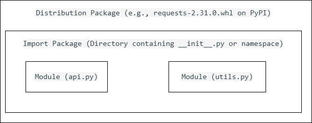

# Python Packages & Libraries

## Modules vs. Packages vs. Distributions

- Each term refers to a distinct structural boundary in the ecosystem.



### Module
- A module is the fundamental unit of code organization in Python.
- A single `.py` file (or a compiled C/Rust extension module) containing executable statements, function definitions, classes, and variable bindings.
- *Example:* `math.py`, `my_app/utils.py`.
- *Import Syntax:* `import utils` or `from my_app import utils`.

### Package
- A package is a specialized module that acts as a container for other modules or nested packages.
- Physically, it is a directory on disk containing source files.
- **Regular Package:** A directory containing an explicit `__init__.py` file.
- **Namespace Package (PEP 420):** A directory without an `__init__.py` file, allowing a single logical package to be split across multiple separate directories or distribution archives on `sys.path`.
- *Example:* A directory named `my_package/` containing an `__init__.py` and child modules.

### Distribution (or "Distribution Package")
- A distribution is a versioned archive file (`.whl` or `.tar.gz`) published to a package index like PyPI or installed via package managers like `pip` or `uv`.
- A single distribution can contain one or more importable packages, single modules, metadata files, and executable binary scripts.
- *Example:* `pydantic-2.6.0-py3-none-any.whl`.
- **Distinction Rule:** We install distributions via package managers (`pip install pydantic`), but we import packages or modules in Python code (`import pydantic`).

## Package Execution Lifecycle

### The Role of `__init__.py`
- When Python imports a package directory for the first time, it automatically executes the `__init__.py` file inside that directory before making any submodules available.
- **Recommended Functions of `__init__.py`:**
	- *Package Namespace Initialization:* Run one-time setup required for the package to operate.
	- *Explicit Public Interface (`__all__`):* Re-export symbols from internal submodules to provide a clean top-level API surface for library consumers.
	- This pattern allows consumers to invoke `from my_package import APIClient` directly, rather than exposing deep internal directory structures like `from my_package.core.client import APIClient`.

	```python
	# my_package/__init__.py
	from my_package.core.client import APIClient
	from my_package.core.exceptions import ConnectionError

	# Explicitly declare public symbols accessible during wildcard imports
	__all__ = ["APIClient", "ConnectionError"]


	# some-service.py
	from my_package import * # only imports symbols listed in __all__
	client = APIClient() # Works fine
	_internal_helpers.do_something() # Fails with NameError: name '_internal_helpers' is not defined
	```

- For enterprise codebases, adding `import-linter` allows defining architectural rules in `pyproject.toml` to prevent consumers or higher-level modules from importing internal packages.

	```toml
	# pyproject.toml
	[tool.importlinter]
	root_package = "my_package"

	[[tool.importlinter.contracts]]
	name = "Forbidden private imports"
	type = "forbidden"
	source_modules = ["my_package.external_consumer"]
	forbidden_modules = ["my_package._internal_helpers"]
	```

### The Role of `__main__.py` and Package Execution
- The `__main__.py` file defines the entry point when a package directory is executed directly from the terminal using Python's `-m` (module execution) flag.
- `python3 -m my_package`
- When this command is invoked:
	1. Python locates `my_package` on `sys.path`.
	2. Python executes `my_package/__init__.py`.
	3. Python executes `my_package/__main__.py` with the special context variable `__name__ == "__main__"`.
- This mechanism allows a package to function both as an importable library and as a runnable CLI application.

```python
# my_package/__main__.py
import sys
from my_package.cli import main_entrypoint

if __name__ == "__main__":
    sys.exit(main_entrypoint())
```

### `$PYTHONPATH`
- It is an environment variable used to inject additional search directory paths into `sys.path` during interpreter initialization.
- Directories listed in `PYTHONPATH` are inserted into `sys.path` immediately after the script's invocation directory, but before standard library and `site-packages` locations.
- While useful for quick local debugging, relying on `PYTHONPATH` in production or application code is considered anti-pattern behavior.
- Setting up editable installs (`pip install -e .` or `uv pip install -e .`) using a standard `pyproject.toml` layout is the recommended rule to follow for resolving local imports deterministically across team environments.

## Distribution Formats


- Python code is distributed in two primary artifact formats.

### Source Distributions (`sdist`)
- An `sdist` is an uncompiled gzipped tar archive (`.tar.gz`) containing raw Python source code, non-code assets, and build instructions.
- *File Naming Convention:* `package-version.tar.gz` (e.g., `requests-2.31.0.tar.gz`).
- Characteristics:
	- Contains build configuration files (e.g., `pyproject.toml`, `setup.py`).
	- Platform-agnostic (contains no pre-compiled binaries).
	- When installing an `sdist`, the target system must execute the build backend locally to compile C/Rust code or assemble the package before installation can complete.

### Built Distributions: Wheels (`.whl`)
- A Wheel is a ready-to-install zip archive (`.whl`) structured to be unpacked directly into a target `site-packages` directory without executing build code.
- Defined under PEP 427, wheels eliminate code execution during the installation phase.
- *File Naming Convention (PEP 425 Tags):* `{distribution}-{version}-{python_tag}-{abi_tag}-{platform_tag}.whl`
- For production application deployments, prioritizing wheel installations is the recommended rule to follow.
- This guarantees fast, deterministic deployments and eliminates the requirement for heavy C/Rust toolchains inside production runtime containers.

	```
	# Example 1: Pure Python wheel (runs on any platform and Python 3 interpreter)
	requests-2.31.0-py3-none-any.whl

	# Example 2: Compiled C extension wheel (bound to CPython 3.11 on x86_64 Linux)
	pydantic_core-2.14.6-cp311-cp311-manylinux_2_17_x86_64.whl
	```

### Key Differences Matrix

| Attribute | Source Distribution (`sdist`) | Built Distribution (wheel) |
|---|---|---|
| File Extension | `.tar.gz` | `.whl` |
| Installation Speed | Slow (requires local build processing) | Fast (direct copy/extraction operation) |
| Compiler Requirement | Target machine requires C/Rust compilers for native code | Pre-compiled; no local build tools required |
| Security Profile | Executes setup hooks or build backends during install | Pure static extraction; no arbitrary code execution |
| Portability | Universal source archive | Can be universal (`py3-none-any`) or `platform-specific` |

## Pure Python vs. Compiled/Native C/Rust Extension Packages

- Python libraries fall into two architecture categories based on whether their execution requires native compilation.

### Pure Python Packages
- Libraries composed entirely of standard Python modules without native C/C++/Rust dependencies.
- *Example:* `requests`, `urllib3`, `jinja2`.
- *Build Characteristics:* A single build produces one `sdist` and one universal wheel tagged `py3-none-any.whl`.
- *Deployment Advantages:* Completely portable across operating systems and architecture targets.

### Compiled/Native Extension Packages
- Libraries that offload performance-critical tasks to compiled C/C++ libraries or Rust code via Python's C-API or Foreign Function Interfaces.
- *Example:* `numpy`, `cryptography`, `pydantic-core`, `polars`.
- *Build Characteristics:* Must be compiled separately for every targeted operating system, CPU architecture, and CPython ABI version combination.
- *The `cibuildwheel` Workflow:* Maintainers of compiled packages use tools like `cibuildwheel` inside CI/CD matrix builds to generate dozens of platform-specific wheel files for distribution on PyPI.

## Package Distribution

- To share a library or tool with the world, it must be compiled into distribution artifacts (`sdist` and `.whl`) and uploaded to a package repository like PyPI (Python Package Index) or TestPyPI.

### Configure Package Metadata
- Organize source code inside a src/ directory layout and ensure metadata fields are populated in `pyproject.toml`.

```
my-lib/
├── pyproject.toml
├── README.md
└── src/
    └── my_lib/
        ├── __init__.py
        └── core.py
```

```toml
[project]
name = "my-lib-example"
version = "0.1.0"
authors = [{ name = "Your Name", email = "you@example.com" }]
readme = "README.md"
requires-python = ">=3.11"
dependencies = []

[build-system]
requires = ["hatchling"]
build-backend = "hatchling.build"
```

### Build Distribution Artifacts
- Run the build frontend tool (`uv build` or Python's standard build tool) from the root directory.

```bash
# Build package using uv
uv build

# This creates a dist/ folder containing the compiled distribution files:
# dist/
# ├── my_lib_example-0.1.0-py3-none-any.whl
# └── my_lib_example-0.1.0.tar.gz
```

### Publish to PyPI / TestPyPI
- Authenticate with PyPI using API tokens or Trusted Publishers (OIDC).
- `twine` is the standard tool used to securely upload artifacts.

```bash
# Install twine into an isolated environment
uv tool install twine

# Upload to TestPyPI first to verify layout and rendering
twine upload --repository testpypi dist/*

# Upload to Production PyPI
twine upload dist/*
```