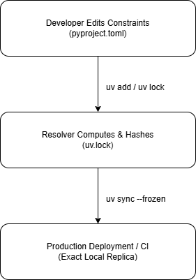

# Packaging Architecture

> All contents here are generated by Gemini.

## Evolution of Python Tooling

### The Legacy Era

#### `requirements.txt`
- Historically, `pip` introduced `requirements.txt` as a flat list of dependencies.
- It was designed for environment reproduction rather than package metadata.

**Architectural Limitations:**

- *No Transitive Dependency Resolution:*
	- Installing requests also installs its dependencies (like `urllib3`, `certifi`, `idna`).
	- Freezing this environment via `pip freeze > requirements.txt` mixes direct dependencies with sub-dependencies, masking top-level intent.
- *No Multi-Environment Standards:*
	- To separate development or testing libraries from production code, projects had to maintain arbitrary naming conventions like `requirements-dev.txt` or `requirements-test.txt`.
- *No Metadata Capabilities:*
	- It cannot describe package names, version constraints for the Python runtime itself, entry points, or build systems.

**Sample:**

```
requests==2.31.0
pandas>=2.0.0
pytest
```

#### `setup.py` and `setup.cfg`
- To build and distribute software, Python traditionally relied on `distutils` and later `setuptools`.
- Package definitions were written in executable Python code via `setup.py`.

**Architectural Limitations:**

- *The "Catch-22" Execution Problem:*
	- To read project metadata, a package manager had to execute `setup.py`.
	- If `setup.py` depended on an uninstalled build-time package (e.g., `Cython` or `numpy`), the setup script would crash before the dependencies could even be parsed or installed.
- *Arbitrary Code Execution:*
	- Parsing project metadata required executing untrusted Python code during the resolution phase.
- *Tool Coupling:*
	- The entire ecosystem was coupled directly to `setuptools`.
	- Replacing `setuptools` with alternative build engines required complex workarounds.

**Sample:**

```python
# Legacy setup.py
from setuptools import setup, find_packages

setup(
    name="my_service",
    version="0.1.0",
    packages=find_packages(),
    install_requires=[
        "requests>=2.31.0",
    ],
)
```

### The Bridge: `pip-tools` and Deterministic Builds
- To solve the dependency drift problem caused by `requirements.txt`, `pip-tools` introduced two distinct files.
- `requirements.in`: Contains abstract, high-level direct dependencies.
- `requirements.txt`: Serves as a generated lockfile with exact pins and hashes.
- Running `pip-compile` resolves top-level dependencies, pin exact versions, and emits deterministic sub-dependencies.
- While this brought lockfile capabilities to standard `pip` workflows, configuration sprawl remained high, requiring separate files for metadata (`setup.py`), linter configurations (`.flake8`, `pytest.ini`), and dependencies (`requirements.in`).

**Sample:**

```
# Step 1: Write abstract rules in requirements.in
requests>=2.31.0

# Step 2: requirements.txt Generated by pip-compile (DO NOT EDIT)
certifi==2024.2.2
    # via requests
charset-normalizer==3.3.2
    # via requests
idna==3.6
    # via requests
requests==2.31.0
    # via -r requirements.in
urllib3==2.2.1
    # via requests
```

### The Modern Standard: The Python Enhancement Proposals (PEPs)
- The Python Packaging Authority (PyPA) introduced a unified framework through three foundational PEPs.
- **PEP 518: Declarative Build Requirements**
	- This established `pyproject.toml` as the universal configuration file using the TOML format.
	- It solves the execution "Catch-22" by introducing the `[build-system]` table.
	- *Recommended Practice:*
		- Always declare `[build-system]`.
		- This allows installers to create an isolated temporary environment containing only the declared build backend before triggering package operations.

	```toml
	[build-system]
	requires = ["hatchling>=1.20.0"]
	build-backend = "hatchling.build"
	```

- **PEP 517: Frontend & Backend Separation**
	- This decoupled the tool running the build (the Build Frontend, e.g., `pip`, `uv`, `build`) from the tool creating the distribution artifacts (the Build Backend, e.g., `hatchling`, `flit-core`, `setuptools`, `maturin`).
	- Frontends and backends communicate through a standardized hook interface (such as `build_wheel` or `build_sdist`).

- **PEP 621: Standardized Project Metadata**
	- This unified static project metadata under the `[project]` table.
	- Regardless of the chosen build backend, metadata is now declared using standard schema fields.

	```toml
	[project]
	name = "enterprise_app"
	version = "1.0.0"
	description = "Production service example"
	readme = "README.md"
	requires-python = ">=3.11"
	authors = [
	    { name = "Developer Name", email = "dev@example.com" }
	]
	dependencies = [
	    "pydantic>=2.0.0",
	    "httpx>=0.27.0",
	]

	[project.optional-dependencies]
	dev = [
	    "pytest>=8.0.0",
	    "ruff>=0.3.0",
	]

	[project.scripts]
	my-cli = "enterprise_app.cli:main"
	```

## Structural Specifications of Modern Packaging

### Anatomy of a `pyproject.toml` File

```toml
# ==============================================================================
# 1. BUILD SYSTEM TABLE (PEP 518)
# Defines the tools required to build your project into an installable wheel.
# ==============================================================================
[build-system]
requires = ["hatchling>=1.20.0"]
build-backend = "hatchling.build"

# ==============================================================================
# 2. CORE PROJECT METADATA TABLE (PEP 621)
# Contains standardized package information, dependencies, and requirements.
# ==============================================================================
[project]
name = "my-service"
version = "0.1.0"
description = "A modern production-ready service"
readme = "README.md"
requires-python = ">=3.11"
license = { text = "MIT" }
authors = [
    { name = "Developer Name", email = "dev@example.com" }
]

# Direct production dependencies (Abstract requirements, not pinned to single builds)
dependencies = [
    "pydantic>=2.6.0",
    "httpx>=0.27.0",
]

# Optional dependency groups (Replaces requirements-dev.txt)
[project.optional-dependencies]
dev = [
    "pytest>=8.0.0",
    "ruff>=0.3.0",
    "mypy>=1.8.0",
]

# Command-line executable scripts generated upon installation
[project.scripts]
my-cli = "my_service.cli:main"
```

### Consolidated Tooling Footprint
- Beyond build information and project metadata, `pyproject.toml` serves as a unified configuration location for modern Python code-quality tools.

```toml
# Unified Tooling Configurations inside pyproject.toml

[tool.ruff]
line-length = 88
target-version = "py311"

[tool.ruff.lint]
select = ["E", "F", "I", "B"]

[tool.pytest.ini_options]
minversion = "8.0"
testpaths = ["tests"]

[tool.mypy]
python_version = "3.11"
strict = true
```

## Dependency Graph Mechanics & Locking

### Abstract Rules vs. Concrete Pins (Direct vs. Transitive Dependencies)
- *Direct dependencies* are the libraries the source code imports directly.
- They represent top-level intent and are declared as abstract rules (ranges) inside `pyproject.toml`.
- Abstract rules express intent and compatibility constraints rather than exact releases.
- Allowing version bounds (`>=`, `<`) enables the resolver to safely upgrade sub-dependencies when security patches are published.
- When a project explicitly depends on a library (e.g., `fastapi`), that library declares its own dependencies (e.g., `pydantic`, `starlette`), which in turn declare lower-level requirements (`typing-extensions`, `idna`). These are *Transitive Dependencies*.
- This chain forms a Directed Acyclic Graph (DAG) of transitive dependencies.
- If direct dependencies are declared with flexible ranges (`fastapi>=0.110.0`) without a lockfile, running `pip install` on two different days (or machines) will pull down different sub-dependency versions, introducing non-deterministic bugs.
- A lockfile is a fully resolved, machine-generated inventory recording exact versions, download URLs, and cryptographic hashes for every node in the dependency graph.
- To ensure deployment parity between local development and production environments, builds must be configured to install directly from the lockfile without running re-resolution routines.

### Mechanics of Resolution & Cryptographic Lockfiles
- Dependency resolution is the process of resolving a complete, non-conflicting Directed Acyclic Graph (DAG) from abstract rules.
- Modern resolvers (like `uv` or `poetry`) use advanced algorithms such as PubGrub (a version solver based on Boolean Satisfiability / SAT solvers).
- The solver backtracks up the decision tree to find a combination of versions where every package requirement is satisfied simultaneously.
- Once the graph is resolved, the package manager writes a lockfile.
- Lockfiles do not merely record version numbers; they record cryptographic hashes (SHA-256) for every artifact published to PyPI.
- Why Cryptographic Hashes are Mandatory?
	- Prevention of Dependency Confusion / Tampering: Guarantees that the code downloaded in CI/CD is byte-for-byte identical to the code vetted locally, protecting against compromised upstream repositories.
	- Hermetic Environment Creation: Prevents broken network caches or intercepted mirrors from injecting modified wheels into build pipelines.

### Anatomy and Breakdown of a Lockfile (`uv.lock`)

```toml
# ==============================================================================
# LOCKFILE METADATA
# Defines the lockfile schema version and engine target rules.
# ==============================================================================
version = 1
revision = 1
requires-python = ">=3.11"

# ==============================================================================
# DIRECT DEPENDENCY NODE
# Records the direct dependency version along with its resolved edges.
# ==============================================================================
[[package]]
name = "fastapi"
version = "0.110.0"
source = { registry = "https://pypi.org/simple" }
dependencies = [
    { name = "pydantic" },
    { name = "starlette" },
]
sdist = { url = "https://files.pythonhosted.org/...", hash = "sha256:a1b2c3...", size = 56789 }
wheels = [
    { url = "https://files.pythonhosted.org/...", hash = "sha256:d4e5f6...", size = 12345 }
]

# ==============================================================================
# TRANSITIVE DEPENDENCY NODE
# Fully resolves sub-dependencies required by 'fastapi'.
# ==============================================================================
[[package]]
name = "pydantic"
version = "2.6.4"
source = { registry = "https://pypi.org/simple" }
dependencies = [
    { name = "pydantic-core" },
]
# ... Cryptographic hashes continue
```

### Modern Dependency Workflows & Deterministic Builds



- Declare top-level intent:
	- Add dependencies directly inside `pyproject.toml`.
	- Or, run installation command, e.g. `uv add "httpx>=0.27.0"`.
- Resolve and generate lockfile:
	- Project management tools (`uv`, `poetry`, `pdm`) resolve exact sub-dependency versions and record them in a tool-managed lockfile (such as `uv.lock` or `poetry.lock`).
- Install exact environment:
	- The project management tool reads the lockfile and installs the exact dependency graph.
	- With `uv`: `uv sync --frozen`.

| Operational Step | Legacy Workflow (`pip`) | Modern Workflow (`uv` example) |
|---|---|---|
| Declare top-level dependencies | Hand-edit `requirements.txt` or `requirements.in` | `uv add requests` (updates `pyproject.toml`) |
| Lock exact dependency graph | `pip freeze > requirements.txt` or `pip-compile` | `uv lock` (creates `uv.lock`) |
| Install project & locked packages | `pip install -r requirements.txt` | `uv sync` |

