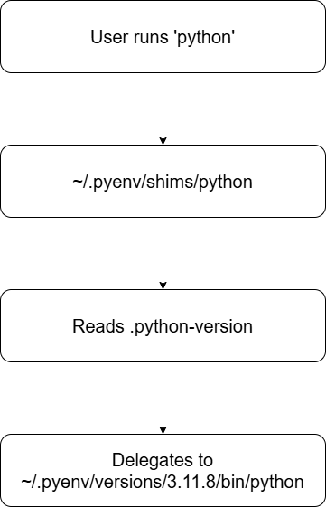
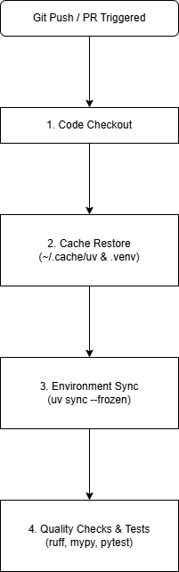

# Project Management

> All contents here are generated by Gemini.

## Ecosystem Tooling Architectures
- Modern Python development uses single unified interfaces that manage environments, dependency resolution, lockfiles, and execution contexts together.

### Python-Native Management Pioneers (`Poetry`)
- `Poetry` pioneered lockfile-driven development in Python.
- It relies on a custom `[tool.poetry]` configuration table inside `pyproject.toml` and uses a pure-Python SAT solver (`PubGrub`) to resolve dependency trees.

#### Working with `Poetry`


```bash
# Initialize interactive project
poetry new user-service
cd user-service

# Add dependencies into [tool.poetry.dependencies]
poetry add "sqlalchemy>=2.0.0"

# Install dev dependencies
poetry add --group dev pytest

# Run commands within virtual environment
poetry run pytest

# Export lockfile to legacy requirements.txt if required by legacy deployment targets
poetry export -f requirements.txt --output requirements.txt
```

### Rust-Powered Consolidated Ecosystems (`uv`)
- `uv` is a drop-in replacement for `pip`, `pip-tools`, `virtualenv`, `pyenv`, and `poetry`.
- Built in Rust, `uv` leverages global content-addressed package caching and copy-on-write file system operations, executing resolution and installation steps 10x–100x faster than legacy tools.

#### Working with `uv`

```bash
# 1. Initialize a modern application structure
uv init my-service
cd my-service

# 2. Explicitly create an isolated virtual environment (uses Python pinned in .python-version)
uv venv

# 3. Add dependencies
uv add "fastapi>=0.110.0" "pydantic>=2.6.0" "httpx>=0.27.0" # Add core runtime dependencies
uv add --dev pytest ruff mypy # Add development-only tooling

# 4. Local Execution and Environment Sync
uv run python -m payment_service.main # Execute local application scripts within managed environment
uv run pytest tests/ # Execute testing pipelines
uv sync # Synchronize virtual environment directly with uv.lock (prunes extraneous packages)
```

The generated `pyproject.toml` declares project rules in standardized format.

```toml
[project]
name = "my-service"
version = "0.1.0"
description = "Dummy Service"
readme = "README.md"
requires-python = ">=3.11"
dependencies = [
    "fastapi>=0.110.0",
    "httpx>=0.27.0",
    "pydantic>=2.6.0",
]

[dependency-groups]
dev = [
    "mypy>=1.8.0",
    "pytest>=8.0.0",
    "ruff>=0.3.0",
]

[build-system]
requires = ["hatchling"]
build-backend = "hatchling.build"
```

#### Task Execution and One-off Tooling
- Traditional Python workflows often require manually creating, activating, and managing virtual environments before executing scripts or running standalone development tools like code linters, test runners, or project generators.
- `uv` simplifies this operational model through two execution commands.
    - `uv run`: for project-scoped task execution. It executes scripts, applications, or commands within the context of a project's managed virtual environment.
    - `uvx`: for ephemeral, one-off global tool execution. It is an alias for `uv tool run`.

## Python Runtime & Version Management
- Production Python applications require strict runtime version isolation.
- Running production code on whatever system interpreter happens to be installed globally on Ubuntu or macOS leads to runtime failures when system packages update.

### Traditional Runtime Management - `pyenv`
- `pyenv` operates by intercepting calls to Python binaries using shell shims.
- `pyenv` is the direct equivalent of NVM (Node Version Manager).
- Its sole job is to download, install, and switch between global and project-specific Python interpreter binaries (3.10, 3.11, 3.12).



```bash
# Install specific CPython binary builds locally
pyenv install 3.11.8
pyenv install 3.12.2

# Set global fallback version
pyenv global 3.11.8

# Pin local directory to specific runtime version
cd /path/to/project
pyenv local 3.12.2 # Creates a .python-version file containing "3.12.2"
```

### Modern Runtime Management - `uv`


- `uv` incorporates Python distribution management natively, removing the need for `pyenv` or shell shim setup.
- It downloads pre-built, production-ready CPython binaries directly from Standalone Python Builds.
- When invoking `uv venv` or `uv run`, `uv` automatically inspects `.python-version` in `pyproject.toml`, fetches the requested Python binary if missing, and provisions the virtual environment using that exact engine.
- uv is conceptually NVM + `npm` + `npx` combined into a single binary.
    - *Managing Python engine versions:* `uv python install 3.12`. Similar to NVM.
    - *Managing dependencies and lockfiles:* `uv add fastapi` / `uv sync`. Similar to `npm`.
    - *Running one-off package tools without global installation:* `uvx ruff check .`. Similar to `npx`.
- While installing `uv` via `pip` is possible (`pip install uv`), it creates a bootstrapping loop. It forces dependence on a system Python interpreter and `pip` installation just to manage Python tools.
- Using the standalone executable installer is the recommended rule to follow.
- Because `uv` is a pre-compiled, self-contained Rust binary, there is no need to have Python pre-installed on the system at all.

```bash
# List available CPython releases and installed local runtimes
uv python list

# Install specific Python versions locally without administrative privileges
uv python install 3.11.8 3.12.2

# Pin local project to specific version
uv python pin 3.11.8 # Writes "3.11.8" into .python-version

# Create virtual environment forced to run on Python 3.12
uv venv --python 3.12
```

- When running `uv init my-app` without specifying a version, uv checks two things:
	- It looks for any existing Python installations managed by `uv` or the system.
	- If none exist (or none meet basic defaults), it automatically fetches and installs the latest stable CPython version in the background into an isolated cache directory.
	- It then generates `.python-version` pinned to that downloaded version (e.g., `3.12.2`) and sets `requires-python = ">=3.12"` inside `pyproject.toml`.
- To use a specific python version use the `--python` flag during initialization.
	- For example: `uv init --python 3.11 my-legacy-service`

## Production Deployment Patterns
- Deploying any applications to production environments requires strict adherence to three core engineering principles.
- **Reproducibility:** ensuring identical code and dependency execution across development, staging, and production.
- **Minimized container attack surfaces:** excluding unnecessary build compilers and shell tools.
- **Optimized image build times:** leveraging layer caching.

### Deterministic CI/CD Synchronization Pipelines



- When running dependency operations in automated pipelines, there are some flags that represent the standard rule to follow.
- `--frozen`
    - Forces `uv` to read `uv.lock` directly without evaluating or updating it against `pyproject.toml`.
    - If a developer modified dependencies in `pyproject.toml` without running `uv lock` locally before committing, the CI job fails immediately.
- `--no-dev`
    - Excludes development-only dependency groups (e.g., `pytest`, `ruff`, `mypy`) from runtime installations, reducing deployment payload size.
- `--locked`
    - Asserts that `uv.lock` is present and fully satisfied without making network calls to check for missing packages.

### Enterprise Dockerization Patterns Using `uv` Multi-Stage Builds

- Building minimal, production-hardened Container Images requires Multi-Stage Docker Builds.
- This strategy separates the build environment (which requires build backends and package download mechanisms) from the runtime environment (which requires only the compiled Python interpreter, virtual environment, and application source code).

#### Key Production Container Optimization Techniques
1. **Decoupling Dependency Layers (`--no-install-project`)**
    - By default, `uv sync` installs both project dependencies and the root project itself.
    - Running `uv sync --no-install-project` first installs only external libraries.
    - Because external dependencies change far less frequently than application source code, Docker caches this heavy layer across daily code pushes.
2. **Bytecode Pre-Compilation (`--compile-bytecode`)**
    - Passing `--compile-bytecode` converts `.py` files into optimized `.pyc` compiled bytecode binaries during image build time.
    - This shifts compilation latency from container startup to image creation, accelerating container boot times in Kubernetes clusters.
3. **Non-Root Execution Security Rule**
    - Containers should never execute process entrypoints as root.
    - Creating a dedicated non-system user mitigates container breakout vulnerabilities in cloud environments.