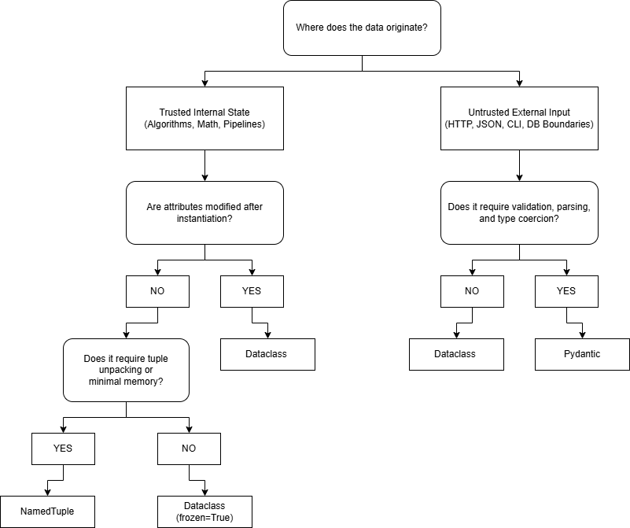

# In-Memory Schemas and Domain Objects

- When modeling entities in Python, selecting the correct container shapes how an application manages state, enforces contracts, and consumes memory.
- Python provides multiple mechanisms for structured data representation:
	- lightweight tuple-backed records via `NamedTuple`
	- mutable or immutable boilerplate-free classes via standard library `dataclasses`
	- schema-enforcing, parse-first domain layers via `Pydantic`.

## Immutable Sequence Records
- Python provides two variants of named tuples.
	- The factory function `collections.namedtuple`.
	- The class-syntax wrapper `typing.NamedTuple`.
- Both produce subclasses of the built-in `tuple`.

### Memory Footprint and Tuple Backing
- A standard Python class stores its instance attributes in a per-instance dictionary (`__dict__`).
- This dictionary incurs noticeable memory overhead due to hash table sizing and dynamic pointer tracking.
- `NamedTuple` instances store their elements strictly as an indexed C array of pointers, identical to a standard Python `tuple`.
- They do not have `__dict__` and `__weakref__` by default, which means zero dictionary hash-table overhead per instance and arbitrary attributes cannot be attached dynamically.
- Because of this layout, `NamedTuple` instances require roughly the same memory as raw tuples while permitting field access through named attributes (`point.x`) alongside numerical indexing (`point[0]`).

```
Standard Object:  [ PyObject Head ] -> __dict__ -> [ Hash Table Buckets (Pointers) ]
NamedTuple:       [ PyObject Head ] -> [ Ptr 0 | Ptr 1 | Ptr 2 ] (Contiguous Array)
```

- `collections.namedtuple` constructs a class dynamically using string identifiers.
- `typing.NamedTuple` provides a class-based syntax compatible with static type checkers.

```python
from collections import namedtuple

# Dynamic type generation
LegacyCoordinate = namedtuple("LegacyCoordinate", ["latitude", "longitude", "altitude"])
point_a = LegacyCoordinate(37.7749, -122.4194, 10.0)

from typing import NamedTuple

class GeoCoordinate(NamedTuple):
    latitude: float
    longitude: float
    altitude: float = 0.0  # Supports default values

point_b = GeoCoordinate(latitude=37.7749, longitude=-122.4194)
```

### Immutable Record Semantics and Tuple Unpacking
- Instances of `NamedTuple` are strictly immutable.
- Updating a `NamedTuple` requires creating a new instance.
- The generated class provides the `_replace()` method for this purpose.

```python
coord = GeoCoordinate(51.5074, -0.1278)

# The following line raises AttributeError at runtime:
coord.latitude = 52.0

# Fields can be unpacked like standard tuples
lat, lon, alt = coord

# Creates a shallow copy with replaced fields
updated_coord = coord._replace(latitude=52.5200)
```

### Gotchas and Failure Modes
- **Unintended Equality Across Dissimilar Types**
	- Because `NamedTuple` inherits from `tuple`, two distinct `NamedTuple` classes with the same field values evaluate as equal to each other, and equal to a plain `tuple`.
	- This behavior can obscure logic errors when comparing distinct domain entities.

```python
class Point2D(NamedTuple):
	x: float
	y: float

class Vector2D(NamedTuple):
	dx: float
	dy: float

p = Point2D(1.0, 2.0)
v = Vector2D(1.0, 2.0)

print(p == v)          # True
print(p == (1.0, 2.0)) # True
```

- **No Static Type Enforcement at Runtime**
	- `typing.NamedTuple` annotations are metadata.
	- They do not validate input types during instantiation.
- **Default Values Precedence:** Once a field defines a default value, all subsequent fields must also specify a default value, matching standard Python positional argument rules.

## Declarative Structural Modeling
Introduced in PEP 557, the `dataclasses` module provides a decorator that inspects class type annotations to automatically generate special methods (such as `__init__`, `__repr__`, and `__eq__`), reducing boilerplate while retaining standard mutable class semantics.

### Mechanical Code Generation
- The `@dataclass` decorator inspects the class annotations and constructs dynamic method bodies compiled onto the class dictionary.
- Unlike `NamedTuple`, the generated `__eq__` method verifies that both operands share the identical class type, preventing cross-type equality bugs.

```python
from dataclasses import dataclass

@dataclass
class InventoryItem:
    sku: str
    unit_cost: float
    quantity_on_hand: int = 0

# Under the hood, @dataclass dynamically generates code equivalent to:
def __init__(self, sku: str, unit_cost: float, quantity_on_hand: int = 0) -> None:
    self.sku = sku
    self.unit_cost = unit_cost
    self.quantity_on_hand = quantity_on_hand

def __repr__(self) -> str:
    return (
        f"InventoryItem(sku={self.sku!r}, unit_cost={self.unit_cost!r}, "
        f"quantity_on_hand={self.quantity_on_hand!r})"
    )

def __eq__(self, other: object) -> bool:
    if other.__class__ is self.__class__:
        return (self.sku, self.unit_cost, self.quantity_on_hand) == (
            other.sku, other.unit_cost, other.quantity_on_hand
        )
    return NotImplemented
```

#### Inheritance and Field Ordering
- When a child dataclass inherits from a parent dataclass, `@dataclass` merges all parent fields followed by child fields into a single combined `__init__` parameter list.
- A subclass cannot define a field without a default value if any parent class defines a field with a default value.
- Python positional argument rules require all defaulted arguments to follow non-defaulted ones.
- This inheritance contraint stems from the same positional parameter rule as `NamedTuple`.

```python
@dataclass
class Parent:
    x: int = 10

# Raises TypeError: non-default argument 'y' follows default argument
@dataclass
class Child(Parent):
    y: int
```

**Solutions**

1. Give child fields default values.
2. Forces fields to be passed as keyword arguments, removing positional ordering constraints.

```python
@dataclass(kw_only=True)
class BaseEntity:
    id: int
    is_active: bool = True

@dataclass
class User(BaseEntity):
    username: str  # Valid! Both can be passed as keyword arguments
```

### Memory Optimization
- By default, dataclass instances store attributes in a standard `__dict__`.
- Supplying `slots=True` (Python 3.10+) directs Python to generate a `__slots__` iterable, eliminating `__dict__` and `__weakref__` allocations.
- Reduces memory consumption by 60%–70% relative to standard dataclasses when managing millions of instances.
- Precludes dynamic assignment of arbitrary attributes not declared as class fields.

```python
@dataclass(slots=True)
class FastTelemetryPoint:
    timestamp: float
    sensor_id: int
    reading: float
```

### Immutability
- Specifying `frozen=True` simulates immutability by altering the generated assignment dunders.
- Under `frozen=True`, the generated `__setattr__` and `__delattr__` methods raise a `FrozenInstanceError`.
- It automatically generates a valid `__hash__` method (provided all individual fields are hashable), permitting instances to serve as dictionary keys or set members.
- `frozen=True` protects the top-level references of an instance, but does not freeze mutable objects held within those fields.

```python
@dataclass(frozen=True)
class ImmutableConfig:
    api_key: str
    timeout_seconds: int = 30

config = ImmutableConfig(api_key="secret-key")
# config.timeout_seconds = 60  # Raises dataclasses.FrozenInstanceError
```

### Field Customization
- Using mutable default values directly in class field definitions causes shared-state bugs across instances.
- Dataclasses disallow mutable literals (such as `[]` or `{}`) in default positions, requiring `field(default_factory=...)` instead.

```python
from dataclasses import dataclass, field
from datetime import datetime

@dataclass
class AuditRecord:
    actor_id: str
    # Incorrect: actions: list[str] = [] -> Raises ValueError at definition time
    actions: list[str] = field(default_factory=list)
    created_at: datetime = field(default_factory=datetime.utcnow)
    internal_hash: str = field(init=False, repr=False)
```

### Post-Initialization Processing
- When a dataclass defines a `__post_init__` method, the generated `__init__` calls it after assigning declared fields.
- This hook handles derived state, validation, or internal setup.
- In a frozen dataclass, writing `self.digest = ...` inside `__post_init__` triggers a `FrozenInstanceError`.
- To bypass the generated `__setattr__` during initial construction, use `object.__setattr__`.

```python
from dataclasses import dataclass, field

@dataclass
class SecurePayload:
    content: str
    digest: str = field(init=False)

    def __post_init__(self) -> None:
        if not self.content:
            raise ValueError("Payload content cannot be empty.")

@dataclass(frozen=True)
class CachedToken:
    raw_token: str
    token_hash: str = field(init=False)

    def __post_init__(self) -> None:
        object.__setattr__(
            self, "token_hash", hashlib.md5(self.raw_token.encode()).hexdigest()
        )
```

## Parsing and Boundary Validation - Modern Pydantic (v2)
- Pydantic is a data validation and parsing library.
- Unlike standard library data structures, Pydantic does not merely hold typed attributes.
= It parses, coerces, and validates incoming data payloads against declarative type schemas.
- In Pydantic v2, the core validation engine is written in Rust (`pydantic-core`), providing a substantial performance improvement over v1.

### Coercion vs. Strict Validation
- By default, Pydantic prefers coercion over outright rejection.
- It converts inputs into the targeted Python types when lossless conversion paths exist.
- To prevent automatic coercion, configure strict mode globally via `ConfigDict` or per field via `Field(strict=True)`.

```python
from pydantic import BaseModel, ValidationError

class UserProfile(BaseModel):
    user_id: int
    is_active: bool
    reputation: float

# Coercion in action:
profile = UserProfile(
    user_id="1042",            # Coerced from str to int
    is_active="yes",           # Coerced from "yes" to True
    reputation=42              # Coerced from int to float
)

print(profile.user_id)         # 1042 (int)
print(profile.is_active)       # True (bool)
print(profile.reputation)      # 42.0 (float)

from pydantic import BaseModel, ConfigDict

class StrictUserProfile(BaseModel):
    model_config = ConfigDict(strict=True)

    user_id: int
    is_active: bool
# With strict mode enabled, passing user_id="1042" raises a ValidationError
```

### Field Customization
- The `Field` function defines validation constraints, aliases, and schema metadata.
- By default, once an `alias` is defined on a field, Pydantic ignores the Python attribute name during initialization and exclusively looks for the alias key.
- To populate fields via either their Python attribute name or their alias, configure `populate_by_name=True` on the model.

```python
from pydantic import BaseModel, Field

class EmployeeRecord(BaseModel):
    full_name: str = Field(min_length=2, max_length=100)
    salary: float = Field(gt=0, le=1_000_000)
    department_code: str = Field(pattern=r"^[A-Z]{3}-\d{2}$")
    external_reference: str = Field(alias="ext_ref")

EmployeeRecord(external_reference="value") # Fails with ValidationError

class FlexibleEmployeeRecord(EmployeeRecord):
    model_config = ConfigDict(populate_by_name=True)

FlexibleEmployeeRecord(external_reference="value") # works
FlexibleEmployeeRecord(ext_ref="value") # also works
```

### Custom Validators - Field and Model Scopes
- Pydantic v2 replaces legacy `@validator` and `@root_validator` methods with `@field_validator` and `@model_validator`.
- `@field_validator` Processes individual fields.
	- Individual fields are validated while the model is still being constructed.
	- Because self does not exist yet, the method cannot be an instance method—it receives the class (`cls`) and the raw/coerced field value (`v`).
	- Can run in either `'before'` mode (evaluating raw input before internal Pydantic coercion) or `'after'` mode (evaluating coerced types).
	- At class creation time, Pydantic checks whether every field name passed to it actually exists on the model.
	- If the field name does not exist, Pydantic immediately raises a `PydanticUserError` when the class is loaded.
	- To silence this check intentionally for inherited/dynamic setups, pass `check_fields=False`.

	```python
	from pydantic import BaseModel, field_validator

	class Transaction(BaseModel):
	    currency_code: str

	    @field_validator("currency_code", mode="after")
	    @classmethod
	    def verify_currency_iso(cls, value: str) -> str:
	        standardized = value.upper()
	        if standardized not in {"USD", "EUR", "GBP", "JPY"}:
	            raise ValueError(f"Unsupported currency: {value}")
	        return standardized
	```

- `@model_validator` inspects multi-field invariants across the entire entity.
	- Can run in `'before'` mode (on the raw input dictionary) or `'after'` mode (on the instantiated model instance).

	```python
	from typing_extensions import Self
	from pydantic import BaseModel, model_validator

	class DateInterval(BaseModel):
	    start_epoch: int
	    end_epoch: int

	    @model_validator(mode="after")
	    def verify_chronological_order(self) -> Self:
	        if self.start_epoch >= self.end_epoch:
	            raise ValueError("start_epoch must precede end_epoch.")
	        return self
	```

### Serialization and Schema Dumping
- Pydantic v2 decouples model parsing from serialization via `model_dump()` and `model_dump_json()`

```python
interval = DateInterval(start_epoch=1000, end_epoch=2000)

# Export as native Python dictionary
data_dict = interval.model_dump(
    include={"start_epoch"},  # Selective inclusion
    exclude_unset=True        # Drops fields that were not explicitly passed
)

# Export directly to a JSON-formatted string
json_str = interval.model_dump_json(indent=2)
```

### Gotchas and Failure Modes
- Pydantic executes extensive type checking, coercions, and validation passes.
- Instantiating a Pydantic model is roughly $10\times$ to $30\times$ slower than a standard dataclass, making it ill-suited for tight internal loops processing millions of records per second.
- By default, Pydantic models are mutable, but post-initialization attribute assignments bypass field validation. To force validation during in-place assignments, enable `validate_assignment`.
- Like `dataclasses`, setting `model_config = ConfigDict(frozen=True)` prevents assigning new values to fields directly on the model, but does not recursively freeze nested mutable collections (e.g., lists).

## Architecture Comparison & Decision Rubric
- Choosing among `NamedTuple`, `dataclass`, and `Pydantic` depends on where the data originates, the performance requirements, and whether the schema represents boundary input or internal state.



### Structural and Behavioral Comparison
| Feature | `typing.NamedTuple` | Standard `dataclass` | `dataclass(slots=True)` | Modern Pydantic (v2) |
|---|---|---|---|---|
| Underlying Type | Built-in `tuple` | Standard Python class | Standard Python class | `pydantic.BaseModel` |
| Mutability | Strictly Immutable | Mutable (or `frozen=True`) | Mutable (or `frozen=True`) | Mutable (or `frozen=True`) |
| Storage Engine | C Array of Pointers | Standard `__dict__` | C-level `__slots__` | Rust `pydantic-core` |
| Validation on Init | None | None | None | Extensive (Coercion + Rules) |
| Performance Overhead | Negligible ($1\times$) | Very Low ($1.2\times$) | Very Low ($1.1\times$) | Moderate ($10\times\text{ to }30\times$) |
| Tuple Unpacking | Supported natively | Unsupported | Unsupported | Unsupported |
| Serialization Support | Native `_asdict()` | Standard `asdict()` | Standard `asdict()` | High-Performance `.model_dump()` |
| Typing Contract | Structural sequence | Nominal | Nominal | Nominal |

### Architectural Rules of Thumb
- Use Pydantic at System Boundaries:
	- Use Pydantic when receiving data from sources outside the direct control of the running Python process, such as HTTP request bodies, environmental variables, configuration files, and external message queues.
	- The parsing and validation layer acts as a firewall against ill-formed inputs.
- Use `dataclasses` (with `slots=True`) for Core Business Entities:
	- Once data is parsed and validated, translate it into internal `dataclasses` or domain objects.
	- Core business logic, mathematical algorithms, and internal data processing pipelines should run without validation overhead on every instantiation.
	- Use `slots=True` to minimize memory usage for high-volume entities.
- Use `NamedTuple` for Lightweight Geometric, Mathematical, or Tabular Tuples:
	- Use `NamedTuple` when an entity represents a fixed coordinate, vector, or tabular database record where immutability is natural and position-based access (unpacking, iteration, slicing) improves readability or integrates with existing tuple-based APIs.
	- Avoid using `NamedTuple` for large business domain entities with complex inheritance or shared equality spaces.